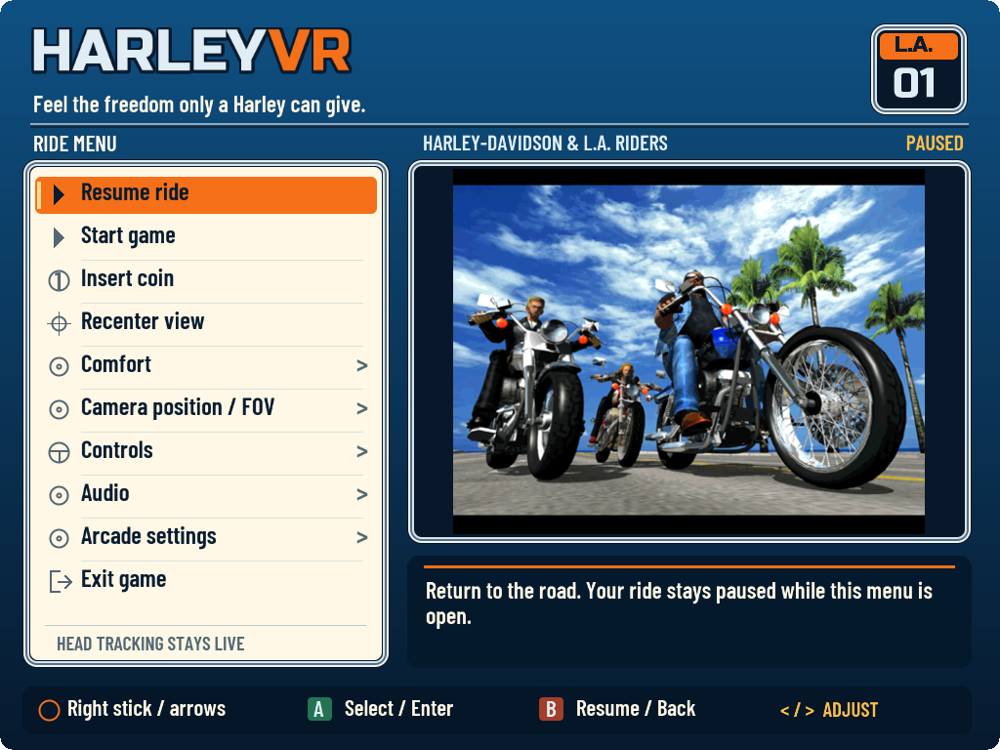
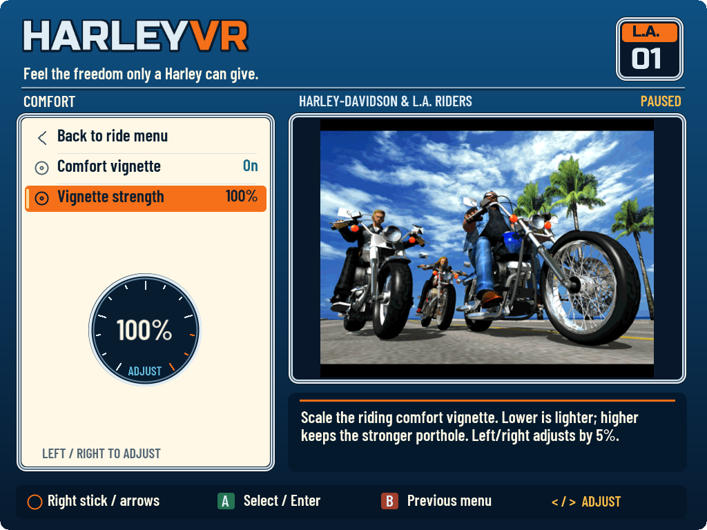
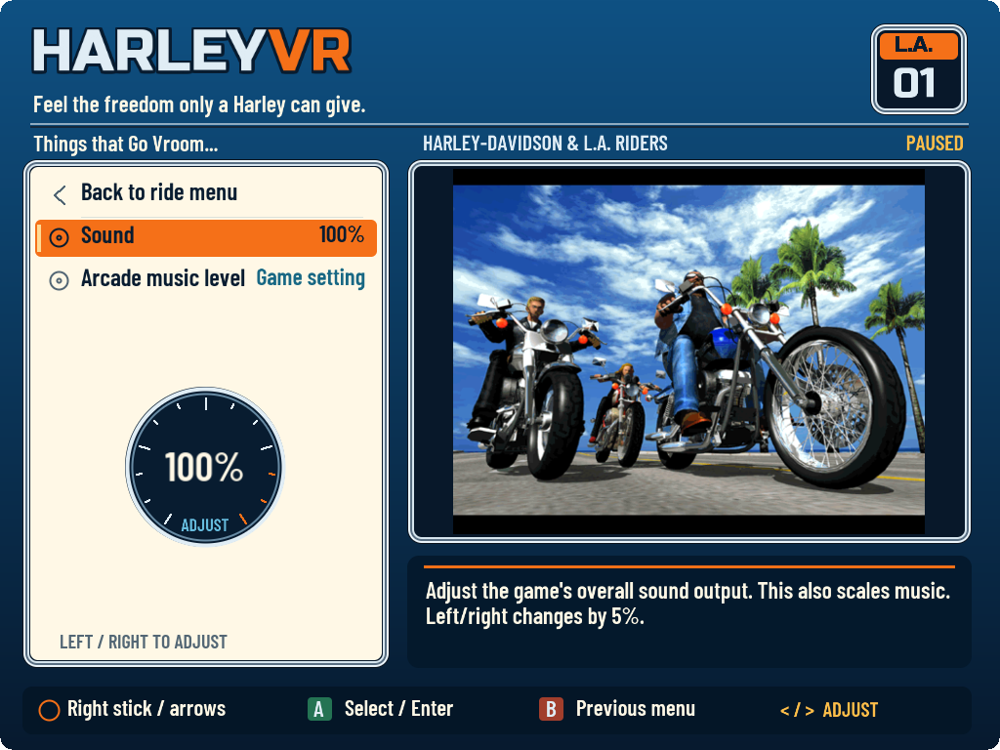

# HarleyVR ride menu

**Menu preview.** The ride menu is in development and awaits headset testing. These desktop previews show the upcoming interface. See [release status](RELEASE-STATUS.md) for availability.

Pause the ride to adjust your view, sound and comfort settings. **Resume** returns to your game, **Start game** sends the arcade start/confirm input, and **Insert coin** adds a credit. **Recenter** places the view and menu in front of you. **Exit game** asks for confirmation.

## Opening and navigating

| Action | Keyboard | VR controllers |
| --- | --- | --- |
| Open / close panel | Tab or Alt+P | Menu / Options, when available to the game |
| Move between rows | Up / Down | Right stick up / down |
| Adjust selected setting | Left / Right | Left stick left / right |
| Select / confirm | Enter | A / Cross |
| Back within this menu | Backspace or Escape | B / Circle |

Escape also opens the panel during riding. **Back** navigates this settings panel; the original arcade game keeps its own controls. Let the sticks and buttons return to neutral when resuming. If your headset reserves its menu button for system software, use keyboard Tab.

## Comfort, camera and display

| Setting | What it changes | Takes effect |
| --- | --- | --- |
| Comfort vignette | Turns peripheral dimming on or off; remembers your chosen strength | Immediately |
| Vignette strength | Adjusts peripheral dimming from 0–100% | Immediately |
| Rider height / camera pullback | Changes the seated camera offset, in game units rather than metres | On Resume |
| Virtual screen width | Changes the apparent width of theater screens, from 40–100 degrees | Immediately |
| Desktop FOV | Changes the desktop preview's field of view | On Resume; unavailable in headset sessions |
| Headset render quality | 50% Performance, 75% Balanced or 100% Quality of the runtime's recommended eye dimensions | **Next launch** |

Higher render quality gives a sharper image and requires more GPU power. It leaves the headset refresh rate and lens FOV unchanged. Camera stabilization and the dark surroundings of theater screens remain active when the vignette is off. Some hills may still trigger the vignette when enabled.

## Sound

**Master sound** adjusts all game audio immediately, including music. **Music level** uses the arcade game's scale: **0 / Game setting** keeps the cabinet choice, while **1–8** runs from quieter to louder. Music changes apply on the **next launch**. This option supports Revision B and is unavailable for other revisions.

## Physical wheel or joystick travel

With a physical steering axis assigned, lower **Steering travel** to reach full steering with less movement. For example, 50% reaches full steering sooner than 100%. Your wheel's hardware rotation stops and existing dead zone stay unchanged.

This setting applies to a single mapped wheel or joystick axis, rather than the VR-controller thumbstick. It is unavailable for unsupported or combined bindings. Specific wheel models, including the Logitech G29, still need testing. **Wheel force feedback is not implemented**; VR-controller vibration is a separate feature.

## Original arcade settings and Free Play

Choose **Arcade settings → Enter arcade settings** to open the original cabinet menu. **Entering arcade settings ends the current ride.** Exit the cabinet menus to return to the arcade's startup flow; the interrupted ride does not resume. While arcade controls are active:

| Function | Keyboard | VR controllers |
| --- | --- | --- |
| Test / select | 6 | A / Cross |
| Service / next item | 5 | X / Square |

To choose Free Play using the original cabinet menu:

1. Open **COIN ASSIGNMENTS**.
2. Use Service to reach **COIN/CREDIT SETTING**, then Test to select **#27 / FREE PLAY**.
3. Select **EXIT** in each original arcade menu to save the cabinet settings and return to the arcade's startup flow.
4. Reopen the HarleyVR panel and leave arcade controls to restore the normal riding mapping.

Use the cabinet menu's **EXIT** options before leaving arcade controls in HarleyVR. Free Play is optional; existing cabinet settings are preserved until you change them. For more detail, see the original [SEGA owner's manual](https://www.arcade-museum.com/manuals-videogames/H/Harley-Davidson_00004.pdf), printed pages 26–27.

To reveal the region selector, open **GAME ASSIGNMENTS**, then enter **Shift up, Shift up, Shift down, Shift down, View, Music, View, Music**. These inputs remain available while arcade controls are active.

## Preferences and artwork

Menu preferences are stored in **`Config/HarleyVRMenu.ini`** for your profile. Your original `Supermodel.ini`, ROM archive and save slots remain unchanged. If preferences cannot be saved, the previous settings file is kept.

The three-rider picture comes from your own game ROM. Its sunny skyline and the original promotional lines “Feel the freedom only a Harley can give.” and “Things that Go Vroom...” bring the arcade's presentation into the menu. The game artwork and promotional material belong to their respective rights holders.
