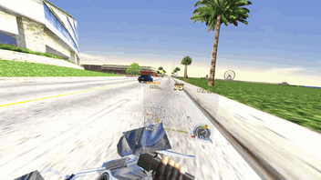
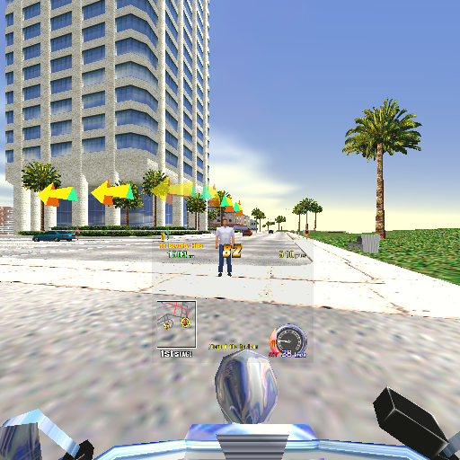
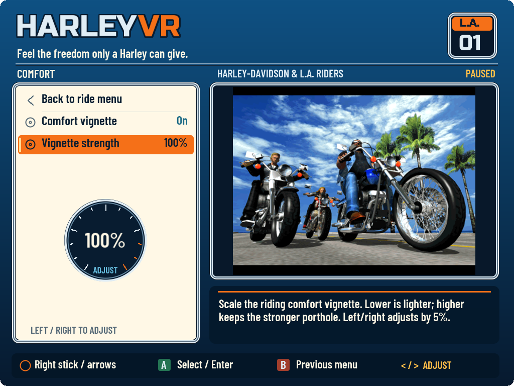
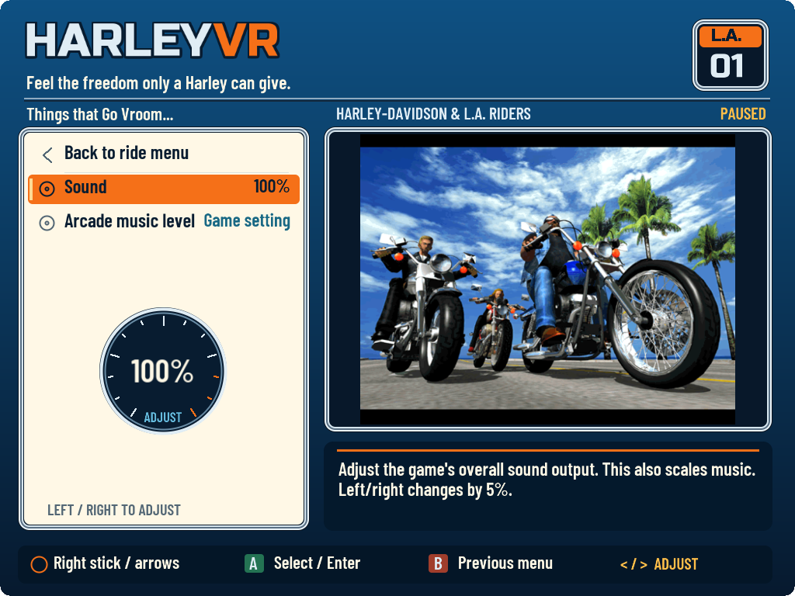

<b><a href="#the-ride">Features</a> · <a href="#screenshots">Screenshots</a> · <a href="#the-psvr2-ride-menu">Ride menu</a> · <a href="#getting-started">Setup</a> · <a href="#controls">Controls</a> · <a href="#known-limitations">Known limitations</a> · <a href="Docs/BUILDING.md">For developers</a></b>

# HarleyVR

**Experience Harley-Davidson & L.A. Riders from the rider's seat in PC VR.**

 October 2026 PSVR2 development build, recorded from the SteamVR mirror. Select the animation for a larger view.

Cruise the streets of Los Angeles, look into a corner and choose your ride in 3D. HarleyVR is an unofficial VR conversion built on the [Supermodel emulator](https://github.com/trzy/Supermodel), with stereoscopic depth, independent head tracking and VR controller support.

> **Windows beta v0.1.0-beta.1.** The [Releases page](https://github.com/WiseSoundDaryl/harley-supermodel-vr/releases) lists published downloads. Choose **HarleyVR-Windows-x64.zip** for play.
>
> **Bring your own game.** HarleyVR requires a legally obtained **Revision B** ROM set, `harleyb.zip`. ROMs are not included; please do not request or upload them here.

## The ride

- **First-person riding:** a raised viewpoint, visible bike and familiar arcade steering.
- **Genuine stereo depth:** separate views for each eye, with independent head tracking to look around as you ride.
- **Immersive rider selection:** explore the bikes and riders in the game's 3D selection scene.
- **Comfort options:** camera stabilization and vignettes for abrupt movement, with theater presentation for intros and flat screens.
- **VR controller support:** steer, accelerate, brake, change view and feel feedback from crashes and hard landings.
- **Smoother scene motion:** interpolation improves movement between game frames while preserving the original arcade simulation speed.

Regular arcade play is the default on both headsets. PSVR2 also offers **Bonus → Dream Ride** at startup for a ride with the gameplay HUD and countdown disabled.

## Screenshots

<table>
<tr>
<td width="50%" align="center"> <b>The rider's view</b> Original arcade scenery and the regular HUD.</td>
<td width="50%" align="center"> <b>Look around independently</b> The same scene, viewed from a different head pose.</td>
</tr>
<tr>
<td width="50%" align="center"> <b>Choose your ride</b> Rider selection stays in the 3D world.</td>
<td width="50%" align="center"> <b>A screen when it makes sense</b> Transmission selection in the virtual theater.</td>
</tr>
</table>

Single-eye screenshots from the desktop VR renderer. Game visuals belong to their respective owners.

## The PSVR2 ride menu

**On PSVR2, the ride menu is available at startup and during play.** Pause your ride to adjust comfort, camera position, display quality and audio, or open the original arcade settings.

<table>
<tr>
<td width="33%" align="center"> <b>Everything starts here</b> Resume, start, insert a coin or recenter.</td>
<td width="33%" align="center"> <b>Make the ride yours</b> Comfort strength, camera position and display options.</td>
<td width="33%" align="center"> <b>Things that Go Vroom...</b> Master sound and supported arcade music levels.</td>
</tr>
</table>

Desktop interface previews. The design uses original game artwork and typography inspired by its arcade-era flyers.

The menu includes a vignette toggle and strength control, rider height and camera pullback, virtual-screen size, render-quality presets and audio settings. It also provides access to the game's **Test/Service menu**, including Free Play and other cabinet options. Existing arcade settings are preserved until you change them.

Click the **left stick** to open or close the menu. You can also hold the **left side grip** and click the **right stick**. The PS/Home buttons open SteamVR. The dedicated Rift S edition uses the original arcade interface. See the [menu guide](Docs/MENU.md) for navigation, settings and Free Play setup.

## Getting started

1. Extract **HarleyVR-Windows-x64.zip** into a writable folder. Keep the executable, both headset folders and their companion files together.
2. Put your own Revision B archive at `ROMs/harleyb.zip`. Leave it zipped.
3. For **PSVR2**, start SteamVR and use **HarleyVR-SteamVR.exe**. For **Rift S**, open Meta Horizon Link, leave SteamVR closed and use **HarleyVR-Meta.exe**. **HarleyVR.exe** offers both choices.
4. On PSVR2, choose **Enter game** from the ride menu. Move between rows with the **right stick**, select with **Cross**, and go back with **Circle**. In the arcade game, insert a coin with **Square / X** and start with **Cross / A**. The Meta launcher temporarily disables Asynchronous Spacewarp and restores the previous setting on exit.

To add the PSVR2 shortcut to your Steam library, choose **Games → Add a Non-Steam Game**, browse to **HarleyVR-SteamVR.exe**, then enable the VR-library option in the shortcut properties if available.

### Compatibility

| Setup | Status |
| --- | --- |
| Windows 64-bit + PSVR2 + official PC adapter + SteamVR | Playtested |
| Windows 64-bit + Rift S + Touch controllers + direct Meta OpenXR | Playtested, including crash and landing vibration |
| Quest 2 / other PC VR headsets | Testing pending |
| Linux / macOS / standalone headset installation | Not supported by the first release |

We playtested on Windows 11 Pro with an AMD Ryzen 7 5800X3D, an NVIDIA GeForce RTX 3090 (24 GB), and 32 GB RAM. The Rift S was set to **80 Hz** and the PSVR2 to **120 Hz**. Frame delivery varies with the headset and render preset. Minimum PC requirements are still being established.

## Controls

PSVR2 Sense and Rift S Touch mappings for the regular-game configuration:

| PSVR2 Sense | Rift S Touch | Action |
| --- | --- | --- |
| **Left stick** | **Left stick** | Steer / move through rider choices |
| **R2** | **Right trigger** | Accelerate |
| **L2** | **Left trigger** | Brake |
| **Cross** | **A** | Start / confirm |
| **Square** | **X** | Insert coin |
| **Triangle** | **Y** | Change view |
| **Circle** | **B** | Game special / music selection |
| **Right stick up / down** | **Right stick up / down** | Manual gear change |
| **Right stick click** | **Right stick click** | Recenter |
| **Left stick click** | — | Open / close the PSVR2 ride menu |
| **Both side grips, held for 2 seconds** | **Both side grips, held for 2 seconds** | Exit without confirmation |
| **Keyboard Home** | **Keyboard Home** | Recenter |
| **Keyboard Escape** | **Keyboard Escape** | PSVR2 opens the ride menu or goes back. Rift S exits the game. |
| **Keyboard F5 / F7** | **Keyboard F5 / F7** | Save / load the selected emulator save slot |

In the [PSVR2 ride menu](Docs/MENU.md), Escape/Backspace and Circle go back. Choose **Exit game** and confirm to quit. On Rift S, use **Alt+P** to pause or resume.

During riding, Circle/B controls the game's music/special input. Controller vibration covers crashes and hard landings; headset rumble is not implemented.

## Comfort and presentation

The driving camera softens bumps and impacts, and a binocular vignette narrows peripheral vision during abrupt motion. Rider selection, riding and the ending remain immersive; intros, AT/MT selection and flat screens appear in a dark virtual theater. Start seated, recenter before riding and stop if you feel uncomfortable.

## Known limitations

- **Original visibility limits:** traffic, pedestrians or scenery can disappear when the game stops drawing them outside its original camera view.
- **Object animation:** some vehicle and helicopter components still move at the original game's animation rate.
- **Vignette detection:** hills can occasionally trigger the comfort mask.
- **Text and overlays:** selection and credits depth have been improved; occasional clipping may remain elsewhere.
- **Wheel feedback:** Harley-specific steering-wheel force feedback is not implemented. VR controller vibration is supported. Physical wheel setup, including the Logitech G29, needs further testing.

See [troubleshooting](Docs/TROUBLESHOOTING.md) before reporting a problem.

## Feedback and development

For bug reports, include your build, headset, runtime, render preset, refresh rate and steps to reproduce the issue. Remove personal information from logs, and never attach ROMs or save states.

- [Release status](Docs/RELEASE-STATUS.md)
- [Ride menu and arcade settings](Docs/MENU.md)
- [Build preparation and dependencies](Docs/BUILDING.md)
- [How to report a bug](Docs/TROUBLESHOOTING.md#reporting-a-problem)

## Credits and license

- **Supermodel:** [Bart Trzynadlowski and the Supermodel Team](https://github.com/trzy/Supermodel), whose emulator makes this work possible. The [original manual and acknowledgments](Docs/Supermodel-Manual.txt) are retained.
- **HarleyVR:** project direction and playtesting by [WiseSoundDaryl](https://github.com/WiseSoundDaryl), with AI-assisted development.
- **OpenXR:** Khronos Group; see the [dependency notices](Docs/THIRD-PARTY-NOTICES.md).
- **Community inspiration:** [headsplosion's Lost World PC VR project](https://github.com/headsplosion/lost-world-supermodel-pcvr).

Emulator modifications are licensed under **GPL-3.0-or-later**. Third-party components and font data retain their respective licenses. See [LICENSE](LICENSE) and [third-party notices](Docs/THIRD-PARTY-NOTICES.md).

Harley-Davidson, Harley-Davidson & L.A. Riders, SEGA and other names and marks belong to their respective owners. **This is an unofficial fan project, not affiliated with or endorsed by Harley-Davidson, SEGA or Sony.** The emulator's software license does not license the game, its ROMs or its artwork.
