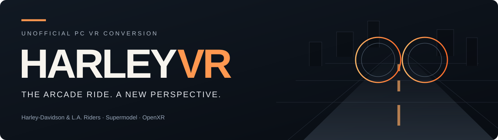
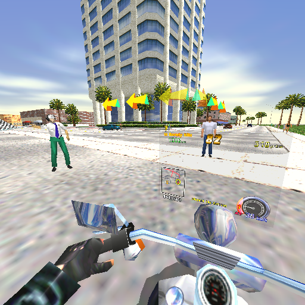
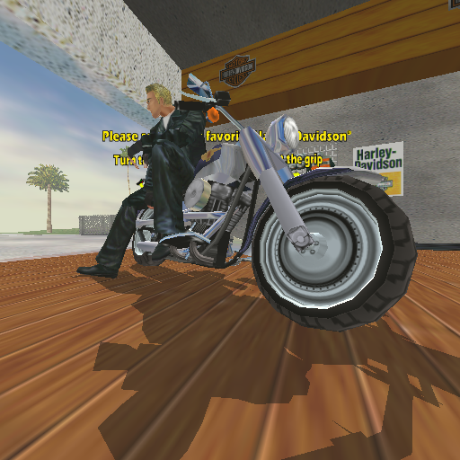
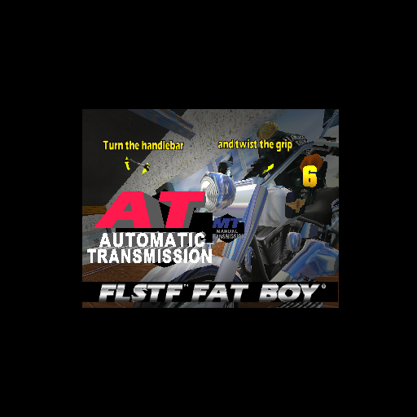
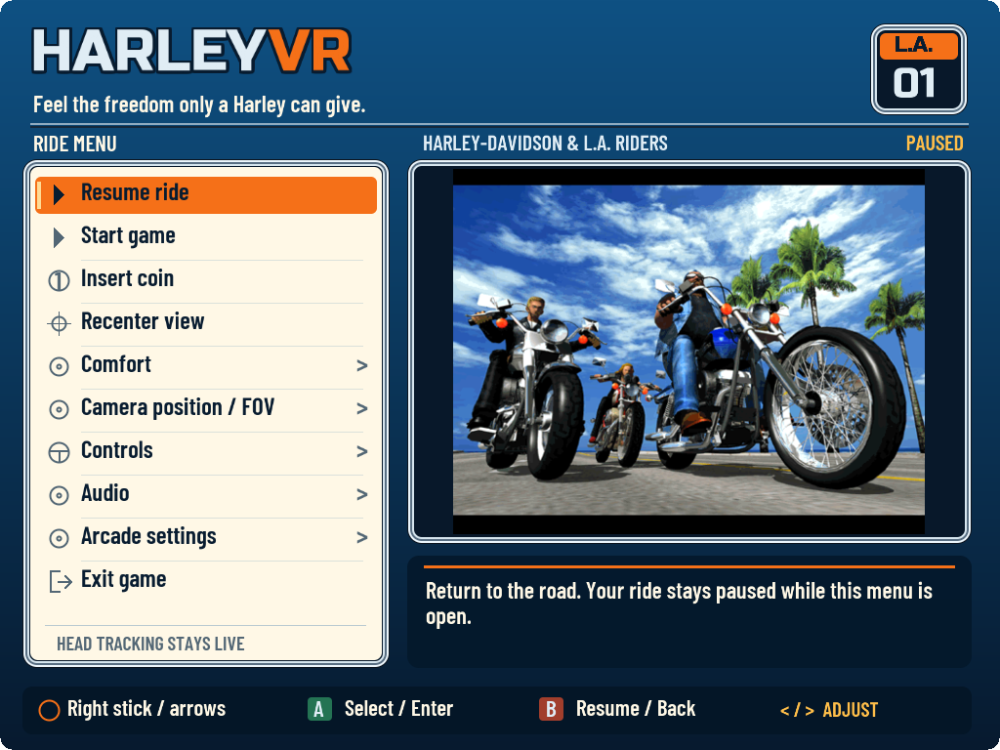

<b><a href="#the-ride">Features</a> · <a href="#screenshots">Screenshots</a> · <a href="#steamvr-ride-menu">Ride menu</a> · <a href="#getting-started">Setup</a> · <a href="#controls">Controls</a> · <a href="#known-limitations">Known limitations</a> · <a href="Docs/BUILDING.md">For developers</a></b>

# HarleyVR

**Play Harley-Davidson & L.A. Riders on Windows with SteamVR or Meta PC VR.** Both editions come in one download.

 Gameplay recorded from the SteamVR mirror in October 2026. Select the animation for a larger view.

Cruise the streets of Los Angeles, look into a corner and choose your ride in 3D. HarleyVR is an unofficial VR conversion built on the [Supermodel emulator](https://github.com/trzy/Supermodel), with stereoscopic depth, independent head tracking and VR controller support.

> **First Windows beta** · [Download HarleyVR for Windows](https://github.com/WiseSoundDaryl/harley-supermodel-vr/releases/download/v0.1.0-beta.1/HarleyVR-Windows-x64.zip) · [Release notes and source](https://github.com/WiseSoundDaryl/harley-supermodel-vr/releases/tag/v0.1.0-beta.1)
>
> **Bring your own game.** HarleyVR requires a legally obtained **Revision B** ROM set, `harleyb.zip`. ROMs are not included; please do not request or upload them here.

**Using a Quest on PC?** One Quest player reported successful riding through SteamVR after relaunching the game. Start **HarleyVR-SteamVR.exe** if you use Steam Link or another SteamVR connection. For direct Meta PC VR, enter a wired Quest Link or Air Link session, close SteamVR, and open **HarleyVR-Meta.exe**. Direct Meta on Quest is still unconfirmed. [Steam Link setup](https://help.steampowered.com/en/faqs/view/0E2C-406B-9135-38A4) · [Meta Link setup](https://www.meta.com/help/quest/509273027107091/)

## The ride

- **First-person riding:** a raised viewpoint, visible bike and familiar arcade steering.
- **Genuine stereo depth:** separate views for each eye, with independent head tracking to look around as you ride.
- **Immersive rider selection:** explore the bikes and riders in the game's 3D selection scene.
- **Comfort options:** camera stabilization and vignettes for abrupt movement, with theater presentation for intros and flat screens.
- **VR controller support:** steer, accelerate, brake, change view and feel feedback from crashes and hard landings.
- **Smoother scene motion:** interpolation improves movement between game frames while preserving the original arcade simulation speed.

Regular arcade play is the default in both editions. In the SteamVR edition, choose **Bonus → Dream Ride** at startup to explore the city without the HUD or countdown.

## Screenshots

<table>
<tr>
<td width="50%" align="center"> <b>The rider's view</b> Original arcade scenery and the regular HUD.</td>
<td width="50%" align="center"> <b>Look around independently</b> The same scene, viewed from a different head pose.</td>
</tr>
<tr>
<td width="50%" align="center"> <b>Choose your ride</b> Rider selection stays in the 3D world.</td>
<td width="50%" align="center"> <b>A screen when it makes sense</b> Transmission selection in the virtual theater.</td>
</tr>
</table>

Single-eye screenshots from the desktop VR renderer. Game visuals belong to their respective owners.

## SteamVR ride menu

The SteamVR edition opens with the ride menu. You can bring it up again during play to adjust comfort, camera position and audio, or enter the original arcade settings. The Meta PC VR edition opens directly into the arcade game.

<table>
<tr>
<td width="33%" align="center"> <b>Everything starts here</b> Resume, start, insert a coin or recenter.</td>
<td width="33%" align="center"> <b>Make the ride yours</b> Comfort strength, camera position and display options.</td>
<td width="33%" align="center"> <b>Things that Go Vroom...</b> Master sound and supported arcade music levels.</td>
</tr>
</table>

Desktop interface previews. The design uses original game artwork and typography inspired by its arcade-era flyers.

The menu includes a vignette toggle and strength control, rider height and camera pullback, virtual-screen size, render-quality presets and audio settings. It also provides access to the game's **Test/Service menu**, including Free Play and other cabinet options. Existing arcade settings are preserved until you change them.

Click the **left stick** to open or close the menu. You can also hold the **left side grip** and click the **right stick**, or press **Tab** on the keyboard. See the [menu guide](Docs/MENU.md) for navigation, settings and Free Play setup.

## Getting started

1. Extract the entire **HarleyVR-Windows-x64.zip** into a writable folder.
2. Put your own complete **Export, Revision B** set at `ROMs/harleyb.zip`. If you already own the standalone Revision B set as `harley.zip`, copy it into `ROMs` and name the copy `harleyb.zip`. Leave it zipped.
3. Choose the launcher for the PC VR software you use. **HarleyVR.exe** also lets you pick either edition.

| Edition | Open first | Launch |
| --- | --- | --- |
| **SteamVR** | SteamVR, with your headset and controllers ready | **HarleyVR-SteamVR.exe**. Choose **Enter game** in the ride menu. |
| **Meta PC VR** | Meta Horizon Link, with SteamVR closed | **HarleyVR-Meta.exe**. The arcade game starts directly. |

**Want a sharper picture in SteamVR?** At startup, open **Graphics → Render quality** and select **Quality (100%)**, then choose **Back → Enter game**. A fresh install uses **Performance (50%)**. **Balanced (75%)** is a middle option if Quality affects smoothness. The percentages apply to SteamVR’s recommended width and height per eye.

In the arcade game, **X / Square** inserts a coin and **A / Cross** starts a ride. The Meta launcher temporarily disables Asynchronous Spacewarp and restores your previous setting on exit.

To launch from your Steam library, choose **Games → Add a Non-Steam Game**, browse to **HarleyVR-SteamVR.exe**, then enable the VR-library option in the shortcut properties if available.

### Compatibility

HarleyVR uses OpenXR on 64-bit Windows. If your headset runs through SteamVR, choose the SteamVR edition. If you use Meta’s PC runtime directly, choose the Meta PC VR edition. Controller bindings can vary by device.

| Edition | Personally playtested with | Refresh rate |
| --- | --- | --- |
| SteamVR | PlayStation VR2 (PS VR2), Sony’s PC adapter and Sense controllers | 120 Hz |
| Meta PC VR | Oculus Rift S and Touch controllers | 80 Hz |

The test PC ran Windows 11 Pro with a Ryzen 7 5800X3D, GeForce RTX 3090 (24 GB), and 32 GB RAM. Reports from players using other PC headsets are welcome.

## Controls

Button labels below are shown for Touch and Sense controllers.

| Action | Control |
| --- | --- |
| Steer / move through rider choices | Left stick |
| Accelerate / brake | Right trigger / left trigger (R2 / L2 on Sense) |
| Start / confirm | A / Cross |
| Insert coin | X / Square |
| Change view | Y / Triangle |
| Game special / music selection | B / Circle |
| Shift up / down in manual | Right stick up / down |
| Recenter | Click the right stick or press **Home** |
| Exit the game immediately | Hold both side grips for 2 seconds |
| Save / load the selected emulator save slot | **F5** / **F7** |

**SteamVR:** Click the left stick or press **Tab** to toggle the [ride menu](Docs/MENU.md). Use the right stick to move between rows, **A / Cross** to select, and **B / Circle** to go back. **Escape** opens the menu while riding or goes back inside it. Choose **Exit game** and confirm to quit.

**Meta PC VR:** **Alt+P** pauses or resumes the arcade game. **Escape** exits.

Controller vibration covers crashes and hard landings. This beta has no headset rumble.

## Comfort and presentation

The driving camera softens bumps and impacts, and a binocular vignette narrows peripheral vision during abrupt motion. Rider selection, riding and the ending remain immersive; intros, AT/MT selection and flat screens appear in a dark virtual theater. Start seated, recenter before riding and stop if you feel uncomfortable.

## Known limitations

- **Original visibility limits:** traffic, pedestrians or scenery can disappear when the game stops drawing them outside its original camera view.
- **Upside-down view on first launch:** one Quest player saw the road and HUD inverted through SteamVR. Relaunching the game restored the view in that session. [Troubleshooting](Docs/TROUBLESHOOTING.md#the-game-appears-upside-down)
- **Object animation:** some vehicle and helicopter components still move at the original game's animation rate.
- **Vignette detection:** hills can occasionally trigger the comfort mask.
- **Text and overlays:** selection and credits depth have been improved; occasional clipping may remain elsewhere.
- **Wheel feedback:** Harley-specific steering-wheel force feedback is not implemented. VR controller vibration is supported. Physical wheel setup, including the Logitech G29, needs further testing.

See [troubleshooting](Docs/TROUBLESHOOTING.md) before reporting a problem.

## Feedback and development

For bug reports, include your build, headset, runtime, render preset, refresh rate and steps to reproduce the issue. Remove personal information from logs, and never attach ROMs or save states.

- [Release status](Docs/RELEASE-STATUS.md)
- [Ride menu and arcade settings](Docs/MENU.md)
- [Build preparation and dependencies](Docs/BUILDING.md)
- [How to report a bug](Docs/TROUBLESHOOTING.md#reporting-a-problem)

## Credits and license

- **Supermodel:** [Bart Trzynadlowski and the Supermodel Team](https://github.com/trzy/Supermodel), whose emulator makes this work possible. The [original manual and acknowledgments](Docs/Supermodel-Manual.txt) are retained.
- **HarleyVR:** project direction and playtesting by [WiseSoundDaryl](https://github.com/WiseSoundDaryl), with AI-assisted development.
- **OpenXR:** Khronos Group; see the [dependency notices](Docs/THIRD-PARTY-NOTICES.md).
- **Community inspiration:** [headsplosion's Lost World PC VR project](https://github.com/headsplosion/lost-world-supermodel-pcvr).

Emulator modifications are licensed under **GPL-3.0-or-later**. Third-party components and font data retain their respective licenses. See [LICENSE](LICENSE) and [third-party notices](Docs/THIRD-PARTY-NOTICES.md).

HarleyVR is an independent, unofficial fan project. SEGA, Harley-Davidson, Valve, Meta and Sony do not sponsor or endorse it. Product names identify the original game, compatible software and tested hardware. Game content and trademarks belong to their respective rights holders. [Trademark and game-content notices](Docs/THIRD-PARTY-NOTICES.md#game-content-and-trademarks)
