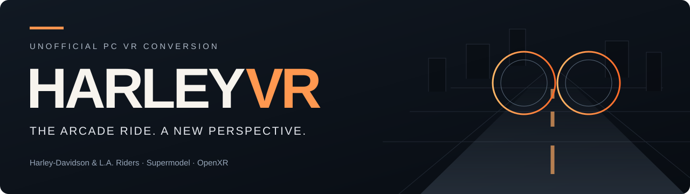
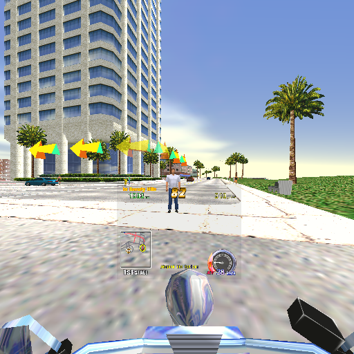
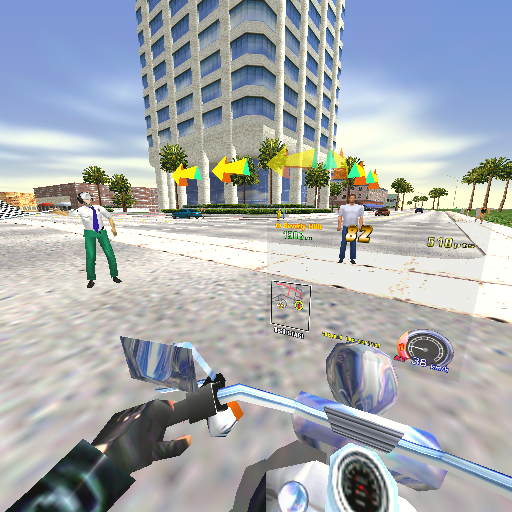
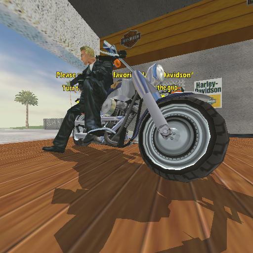
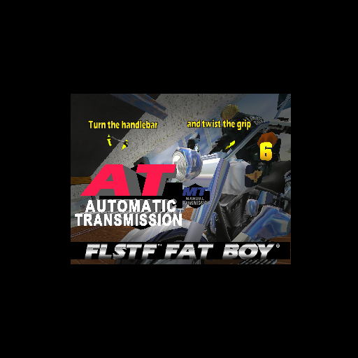

<b><a href="#the-ride">Features</a> · <a href="#screenshots">Screenshots</a> · <a href="#getting-started">Setup</a> · <a href="#controls">Controls</a> · <a href="#known-limitations">Known limitations</a> · <a href="Docs/BUILDING.md">For developers</a></b>

# HarleyVR

**Experience Harley-Davidson & L.A. Riders from the rider's seat in PC VR.**

HarleyVR is an unofficial VR conversion built on the [Supermodel emulator](https://github.com/trzy/Supermodel), with OpenXR stereo rendering, independent head tracking and VR controller input. Look into a corner, glance at the city and ride the original arcade game from a new perspective.

> **Release in preparation.** The first public Windows package is being prepared. VR source integration, portable packaging and final release validation are still in progress; this repository is not yet a downloadable, verified HarleyVR release. Follow [release status](Docs/RELEASE-STATUS.md) for what is ready and what remains.
>
> **Bring your own game.** No ROMs, extracted game models, textures or music are distributed. The planned first release targets the **Revision B** ROM set, `harleyb.zip`, which you must obtain lawfully yourself. Please do not request or upload ROMs here.

## The ride

| In the world | On the bike | Built for the headset |
| --- | --- | --- |
| **Genuine stereo depth.** A separate view is rendered for each eye. | **First-person riding.** A raised rider viewpoint, visible bike and familiar arcade steering. | **Independent head tracking.** Look around while riding; turning the bike still carries your view with the road. |
| **Immersive rider selection.** See the bikes and riders in the game's 3D space. | **VR controller support.** Steer, accelerate, brake, select a rider, insert a coin and change view. | **Comfort treatment.** Stabilization and event-based vignettes reduce some of the original camera's abrupt motion. |
| **Theater presentation.** Intros and flat screens appear on a virtual screen in a dark space. | **Impact feedback.** Controller vibration for detected crashes and hard landings; no engine buzz. | **Smoother scene motion.** Additional headset presentations and conservative scene interpolation, while the arcade simulation keeps its native speed. |

The first release focuses on **regular arcade gameplay**. Experimental walking, free hands, Dream Ride and alternate bike-mounted instruments are outside this release's scope.

## Screenshots

<table>
<tr>
<td width="50%" align="center"> <b>The rider's view</b> Original arcade scenery and the regular HUD.</td>
<td width="50%" align="center"> <b>Look around independently</b> The same scene, viewed from a different head pose.</td>
</tr>
<tr>
<td width="50%" align="center"> <b>Choose your ride</b> Rider selection stays in the 3D world.</td>
<td width="50%" align="center"> <b>A screen when it makes sense</b> Transmission selection in the virtual theater.</td>
</tr>
</table>

Actual, unedited single-eye captures from the October 30 development build's desktop renderer tests. They illustrate the presentation; they are not headset recordings or evidence of headset frame rate. Game visuals belong to their respective owners.

## Getting started

**There is no public player ZIP yet.** These are the intended steps for the first release, after the package is published and validated:

1. Download the Windows player ZIP from [Releases](https://github.com/WiseSoundDaryl/harley-supermodel-vr/releases) and extract it to a writable folder. The source-code ZIP is for developers, not a ready-to-play download.
2. Put your own compatible **`harleyb.zip`** in the package's **`ROMs`** folder. Leave the ROM archive zipped.
3. Install and configure your headset's official PC software. For the initial PSVR2 path, use Sony's PC adapter and the PlayStation VR2 App, and select **SteamVR as the active OpenXR runtime**.
4. Open SteamVR, connect the headset and controllers, and wait until they are ready.
5. Double-click **`Play-HarleyVR.cmd`**. Start seated, look straight ahead and recenter before riding.

The portable launcher is being prepared to use Windows' built-in PowerShell. Players will not need Codex, a compiler or this project's development folders. It will not start SteamVR or change your global runtime settings automatically.

### Compatibility

| Setup | Status |
| --- | --- |
| Windows 64-bit + PSVR2 + official PC adapter + SteamVR | Used for development playtests. The final public package still needs its own validation. |
| Quest 2 / Rift S / other PC VR headsets | Not validated for the first public release. OpenXR support alone is not a compatibility promise. |
| Linux / macOS / standalone headset installation | Outside the first release's scope. |

A development PC with an **NVIDIA RTX 3090** has been used for testing. This is a reference, **not a minimum specification**. Performance depends on CPU, GPU, render resolution and runtime settings. No universal or locked 120 FPS claim is made.

## Controls

PSVR2 Sense mappings for the regular-game configuration:

| Control | Action |
| --- | --- |
| **Left stick** | Steer / move through rider choices |
| **R2** | Accelerate |
| **L2** | Brake |
| **Cross** | Start / confirm |
| **Square** | Insert coin |
| **Triangle** | Change view |
| **Circle** | Game special / music selection |
| **Right stick up / down** | Manual gear change |
| **Right stick click** | Recenter |
| **Options** | Pause, when the runtime delivers this button to the game |
| **Both side grips, held for 2 seconds** | Exit |
| **Keyboard Home / Escape** | Recenter / exit |
| **Keyboard F5 / F7** | Save / load the selected emulator save slot |

The game does not provide a universal Back action. Circle is the game's music/special input; it is not advertised as a horn. Controller haptics cover detected impacts and hard landings; headset rumble is not implemented.

## Comfort and presentation

The driving camera aims to soften the original arcade camera's bumps and impacts. A shared binocular vignette narrows peripheral vision during supported comfort events. Fast menu transitions receive their own treatment, while intros, AT/MT selection and other flat presentation screens use the virtual theater.

Rider selection, main riding and the ending retain immersive 3D where supported. Looking away from a theater screen shows darkness. Camera stabilization does not make bike motion world-locked, and comfort settings cannot guarantee that everyone will tolerate the experience. Start with a short seated session and stop if it feels uncomfortable.

## Known limitations

- **Original game visibility.** Pedestrians, traffic or scenery may disappear outside the original game's camera view. The renderer cannot draw geometry the game stops supplying.
- **Interpolation is selective.** Ambiguous, deformed or rapidly rotating objects may retain native animation steps. Some vehicle or helicopter components can still look less smooth than head movement.
- **Comfort detection is imperfect.** Some hills can trigger the vignette; not every motion event is classified perfectly.
- **Menus and overlays.** Text depth has been improved in tested selection and credits scenes. This is not a universal fix for every possible clipping or polygon depth conflict.
- **Performance varies.** Good development playtests are not a guarantee of identical results on other PCs. The latest candidate has offline validation but no new final-package wearer test.

See [troubleshooting](Docs/TROUBLESHOOTING.md) before reporting a problem.

## Feedback and development

When a public build is available, useful reports include its version, headset, runtime, CPU/GPU, where the problem occurs and steps to reproduce it. A short clip can help distinguish uneven world animation from head-tracking trouble. Remove personal information before sharing logs; never attach ROMs or save states.

- [Release status](Docs/RELEASE-STATUS.md)
- [Build preparation and dependencies](Docs/BUILDING.md)
- [Release checklist](Docs/RELEASE-CHECKLIST.md)
- [Report a bug](https://github.com/WiseSoundDaryl/harley-supermodel-vr/issues/new?template=bug_report.yml)

## Credits and license

- **Supermodel:** [Bart Trzynadlowski and the Supermodel Team](https://github.com/trzy/Supermodel), whose emulator makes this work possible. The [original manual and acknowledgments](Docs/Supermodel-Manual.txt) are retained.
- **HarleyVR:** project direction and playtesting by [WiseSoundDaryl](https://github.com/WiseSoundDaryl), with AI-assisted development.
- **OpenXR:** Khronos Group; see the [dependency notices](Docs/THIRD-PARTY-NOTICES.md).
- **Community reference:** [headsplosion's Lost World PC VR project](https://github.com/headsplosion/lost-world-supermodel-pcvr) was reviewed for technical ideas and clear presentation. Its README text and artwork have not been copied into this page.

Emulator modifications are distributed under **GPL-3.0-or-later**, retaining applicable upstream and third-party terms. See [LICENSE](LICENSE). The matching modified source and required notices must accompany the public binary release; those release checks are still in progress.

Harley-Davidson, Harley-Davidson & L.A. Riders, SEGA and other names and marks belong to their respective owners. **This is an unofficial fan project, not affiliated with or endorsed by Harley-Davidson, SEGA or Sony.** The emulator's software license does not license the game, its ROMs or its artwork.
